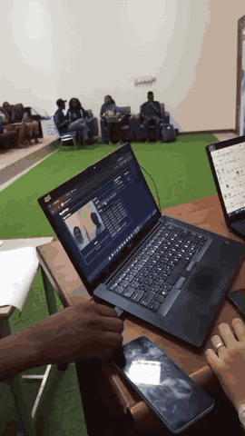

# SignBridge

Open-source, in-browser bridge between sign language and text/speech. Hand tracking runs
locally with MediaPipe; recognition is a tiny KNN classifier you train yourself. Gemma
can turn the recognised letters into a sentence you can read. Speech playback is a
disabled control until that component is added.



The image above is a placeholder. Record a short GIF of both directions and save it as
`docs/demo.gif` before a public demo.

License: MIT.

## Features

- **Sign → Text/Speech.** The camera recognises signs you have trained. **Clean up with AI** asks Gemma to fix spacing and spelling. Speak stays disabled until `src/components/SpeakButton.tsx` exists.
- **Speech → Sign.** The panel is in place for microphone input and sign output.
- **Fails open.** If the API key is missing, the model errors, or the call takes longer than 8 seconds, the original transcript stays on screen.

## Tech stack

- React, TypeScript, and Vite
- MediaPipe hand landmarks and a small in-browser KNN classifier
- Google Generative Language API (`generateContent`) for Gemma
- Vercel for static hosting of the Vite build

## Setup

Requires Node 20+ and [pnpm](https://pnpm.io).

```bash
pnpm install
cp .env.example .env
pnpm dev        # http://localhost:5173 (camera needs localhost or https)
pnpm build      # type-check + production build
```

Put a demo key in `.env`. Do not commit that file.

```bash
VITE_GEMMA_API_KEY=your-demo-key
VITE_GEMMA_MODEL=gemma-3-27b-it
```

`VITE_` values are visible in the browser. The default model id is `gemma-3-27b-it`.
If Google responds that the model is retired, set `VITE_GEMMA_MODEL` to a current Gemma
id on the same API. The path does not change.

There is no separate hackathon base URL in this repository. Requests go to:

`https://generativelanguage.googleapis.com/v1beta/models/{model}:generateContent`

`simplifyForSign()` in `src/lib/gemma.ts` rewrites a transcript into short sentences.
The speech-to-sign panel can call it when that work lands.

Offline use: `public/hand_landmarker.task` is committed to the repo, so the model loads from
your own server. The MediaPipe **wasm** runtime still comes from the jsdelivr CDN on first load
(the browser then caches it). If the model file is ever missing, download it with:

```bash
curl -L -o public/hand_landmarker.task \
  https://storage.googleapis.com/mediapipe-models/hand_landmarker/hand_landmarker/float16/1/hand_landmarker.task
```

## How to train signs

1. Start the app and allow camera access.
2. Type a label (e.g. `A`) in the Training box and press **Record 30 samples**.
3. After a 1.5 s "get ready" pause, hold the sign steady in view. About 30 frames are captured
   over roughly one second.
4. Repeat 2-3 times per sign, moving your hand slightly (closer, further, small tilts) for a
   sturdier model. Samples add up under the same label.
5. Sign normally: when a sign is held for ~10 frames with >60% confidence, its label is added
   to the transcript. To type a double letter ("LL"), take your hand out of view or show a
   different sign in between.
6. Press **Clean up with AI** to turn the transcript into a sentence.

Up to **two hands** are tracked. Train a sign with the same hands in view that you will use when
signing: a one-handed sign is recorded with one hand visible, a two-handed sign with both (their
relative position is part of the sign). The camera preview is mirrored for comfort, but features
are computed on the unmirrored image.

### Sharing a dataset

- **Export JSON** downloads `samples.json`; **Import JSON** merges a file into your data.
- To ship a dataset with the app, put the file at `public/samples.json`. It is loaded on first run
  only (when localStorage has no saved samples). Samples are otherwise persisted in localStorage.

### Tuning

Constants live at the top of `src/hooks/useSignRecognizer.ts` (stability frames, confidence) and
`src/lib/knn.ts` (`K`, `UNKNOWN_DISTANCE`: raise it if known signs show as "—").

## Folder ownership

To avoid merge conflicts, only edit files you own. Change `src/types.ts` by team agreement.
`src/index.css` and `src/main.tsx` are shared; shell-only styles go in `src/App.css`.

| Path                                 | Owner        | Notes                                      |
| ------------------------------------ | ------------ | ------------------------------------------ |
| `src/types.ts`                       | Sign engine  | Shared contracts                           |
| `src/lib/normalize.ts`               | Sign engine  | Landmark normalization                     |
| `src/lib/knn.ts`                     | Sign engine  | KNN classifier                             |
| `src/lib/handLandmarker.ts`          | Sign engine  | MediaPipe setup                            |
| `src/hooks/useSignRecognizer.ts`     | Sign engine  | Main hook                                  |
| `src/components/SignToText.tsx`      | Sign engine  | Camera + training UI                       |
| `src/components/SpeechToSign.tsx`    | Teammate B   | Stub: default export, no props             |
| `src/components/SpeakButton.tsx`     | Teammate B   | Not in the repo yet. Shell shows a disabled Speak button. |
| `src/lib/gemma.ts`                   | Teammate C   | `cleanTranscript` and `simplifyForSign`    |
| `src/App.tsx`, `src/App.css`         | Teammate C   | Header, tabs, cleanup, speak fallback      |
| `README.md`, `CONTRIBUTING.md`, `.env.example`, `vercel.json` | Teammate C | Docs and deploy config          |
| `src/index.css`, `src/main.tsx`      | Shared       | Coordinate before editing                  |

## Contracts

```ts
type Landmark = { x: number; y: number; z: number };
type Sample = { label: string; features: number[] }; // 129 numbers: left 63 + right 63 + wrist offset 3
type Prediction = { label: string; confidence: number };
// <SignToText onText={(text: string) => void} />
// cleanTranscript(raw: string): Promise<string>
// simplifyForSign(text: string): Promise<string>
// <SpeechToSign /> (default export, no props)
```

## Roadmap

- More signs, including everyday phrases rather than only the alphabet.
- Sentence-level recognition, so a whole sign sentence is read instead of one letter at a time.
- Sign languages used locally, with the cleanup prompts translated to match.

## Deploy on Vercel

`vercel.json` builds with `pnpm build`, publishes `dist`, and rewrites unknown paths to
`index.html` so a refresh still loads the app.

1. Push this repository to GitHub.
2. Sign in at [vercel.com](https://vercel.com) and choose **Add New → Project**.
3. Import the repository. Vercel should detect pnpm from `pnpm-lock.yaml`.
4. Framework preset: **Vite**. Build command: `pnpm build`. Output directory: `dist`.
5. Add environment variables before the first deploy:
   - `VITE_GEMMA_API_KEY` — demo key only. It will be inside the public JavaScript.
   - `VITE_GEMMA_MODEL` — optional. Defaults to `gemma-3-27b-it` if unset.
6. Click **Deploy**. Open the production URL, train or type a short transcript, and press **Clean up with AI**.
7. For a later production pass, stop putting the key in `VITE_GEMMA_API_KEY`. Add a serverless route that calls Gemma and change `src/lib/gemma.ts` to call that route.

Command-line deploy:

```bash
npm install -g vercel
vercel login
vercel env add VITE_GEMMA_API_KEY
vercel env add VITE_GEMMA_MODEL
vercel
vercel --prod
```

`vercel` publishes a preview URL. `vercel --prod` updates production.
